<div align="center">

<a href="https://lemomo-ai.github.io/lemo-animi/">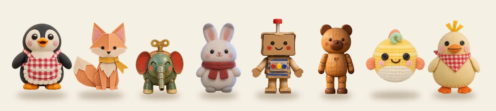</a>

# lemo-animi

**一文から、Codex でストップモーションの短編を。** 画像モデルと組み合わせれば Claude Code でも作れます。

**一句话，用 Codex 做一支定格动画短片。** Claude Code 配一个生图模型也能做。

[**ギャラリーを開く**](https://lemomo-ai.github.io/lemo-animi/) · [スタイルと映像](#8つのスタイルと8本のサンプル映像) · [インストール](#インストール) · [SKILL.md](plugin/skills/lemo-animi/SKILL.md) · [English](README.md) · [简体中文](README.zh-CN.md)

⭐ lemo-animi を気に入っていただけたら、GitHub でスターを付けてください。ほかの人が見つけやすくなります。

🚧 この最初のリリースはまだ開発中のため、粗削りな部分があります。問題が起きた場合は、[issue を作成](https://github.com/lemomo-ai/lemo-animi/issues)してください。ご理解のほどよろしくお願いします。

</div>

Codex に物語を一文で伝えてください。lemo-animi が物語とショットリストを書き、Codex に内蔵された画像生成を使って8種類の素材のいずれかで人形、セット、アクションシートを描き、それらを切り抜いてコードで1コマずつ動かします。本物の楽器サンプルで映像に音楽を付け、フォーリー（効果音）を加え、レビューページを開きます。あなたは承認するまでそこにメモを残せます。動画生成は使いません。見た目を整えるのは画像、動きを付けるのはコードです。Claude Code でも使えます。その場合、絵は Codex または別の画像モデルが描きます。

用一句话把故事告诉 Codex。lemo-animi 自己写故事和镜头表，用 Codex 自带的生图按八种材质之一画出角色、布景和动作表，抠好以后在代码里一格一格地让它们动起来；再用真实乐器采样配乐、加拟音，最后打开审片台，你写意见、它改，直到你点通过。不用视频生成：生图负责「像」，代码负责「动」。Claude Code 也能用，图交给本机的 Codex 或别的生图模型来画。中文说明见 [简体中文 README](README.zh-CN.md) · [中文画廊](https://lemomo-ai.github.io/lemo-animi/zh/)。

> **あなたの指示：** パンケーキをひっくり返すことを覚えるペンギンの、40秒の粘土ストップモーションを作って。

## 8つのスタイルと8本のサンプル映像

各スタイルは固定されたパッケージ（`plugin/skills/lemo-animi/styles/<id>/`）で、プロンプトテンプレート、ライティング、カメラ文法、音楽、フォーリーが含まれています。英語名、中国語名、または id でスタイルを指定してください。すべてのサンプル映像は、スキルが一文から単独で作ったもので、中国語のナレーションと字幕が付いています。カードをクリックするとギャラリーで映像が開き、カードの下のタイトルをクリックすると完全版の映像をダウンロードできます。

<!-- styles:start (generated by docs/build.py from styles/*/style.json and docs/content.json) -->
<a href="https://lemomo-ai.github.io/lemo-animi/#clay">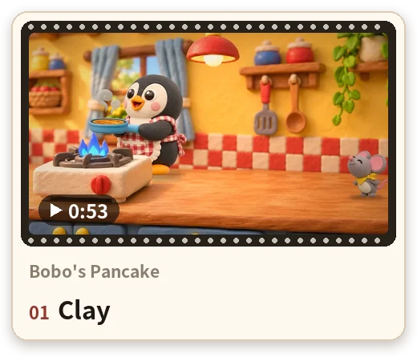</a><a href="https://lemomo-ai.github.io/lemo-animi/#papercraft">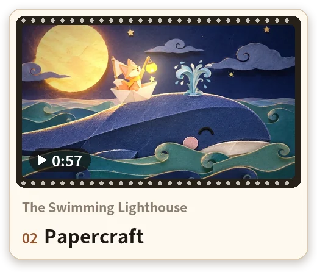</a><a href="https://lemomo-ai.github.io/lemo-animi/#tin">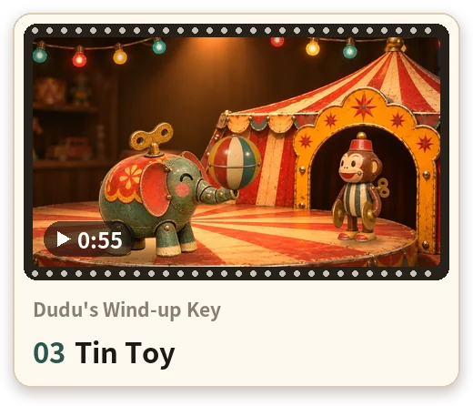</a><a href="https://lemomo-ai.github.io/lemo-animi/#felt">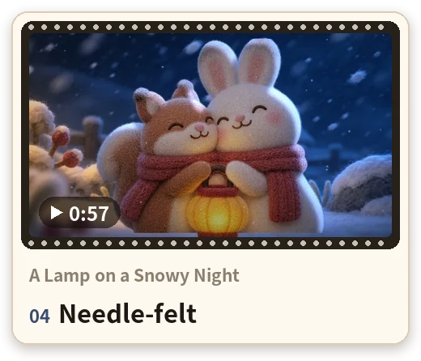</a>

<sub>▶ 完全版の映像：<code>clay</code> <a href="https://github.com/lemomo-ai/lemo-animi/releases/download/films/bobo-pancake.mp4">Bobo のパンケーキ</a> · <code>papercraft</code> <a href="https://github.com/lemomo-ai/lemo-animi/releases/download/films/lantern-whale.mp4">泳ぐ灯台</a> · <code>tin</code> <a href="https://github.com/lemomo-ai/lemo-animi/releases/download/films/dudu-windup.mp4">Dudu のぜんまい</a> · <code>felt</code> <a href="https://github.com/lemomo-ai/lemo-animi/releases/download/films/lantern-snow.mp4">雪の夜のランプ</a></sub>

<a href="https://lemomo-ai.github.io/lemo-animi/#cardboard">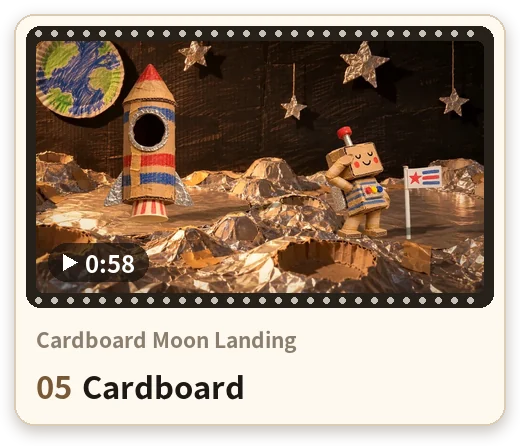</a><a href="https://lemomo-ai.github.io/lemo-animi/#wood">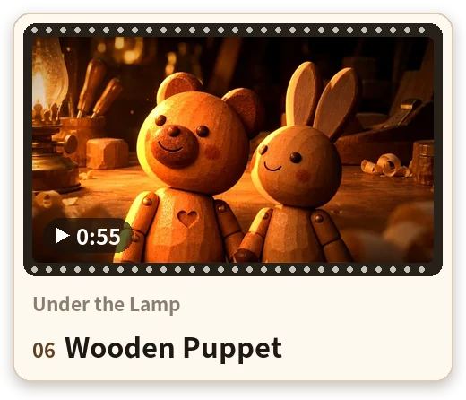</a><a href="https://lemomo-ai.github.io/lemo-animi/#crochet">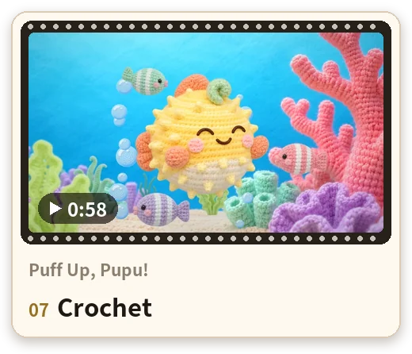</a><a href="https://lemomo-ai.github.io/lemo-animi/#fabric">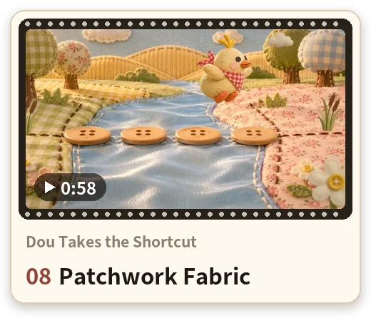</a>

<sub>▶ 完全版の映像：<code>cardboard</code> <a href="https://github.com/lemomo-ai/lemo-animi/releases/download/films/box-moon.mp4">段ボールの月面着陸</a> · <code>wood</code> <a href="https://github.com/lemomo-ai/lemo-animi/releases/download/films/lamp-bear.mp4">ランプの下で</a> · <code>crochet</code> <a href="https://github.com/lemomo-ai/lemo-animi/releases/download/films/pupu-puff.mp4">ふくらめ、Pupu！</a> · <code>fabric</code> <a href="https://github.com/lemomo-ai/lemo-animi/releases/download/films/dou-shortcut.mp4">Dou の近道</a></sub>
<!-- styles:end -->

## 仕組み

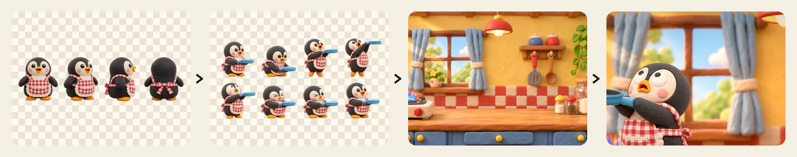

<sub>キャラクターシート → アクションシート → 空の背景 → 映像内のフレーム。シートは画像モデルが描き、コードがそれをセルに切り分けて動かします。</sub>

1. **すべてを一度に質問します。** 一文で指定されなかったこと（スタイル、物語、長さ、サイズ、ナレーション、タイトルカード）を、デフォルトを先頭にした1セットの質問でまとめて尋ねます。その後は最後まで作業を進めます。
2. **計画を立てます。** パートごとの秒数を決めた物語の骨組み（導入、3回の挑戦、どん底、転機）、ビート、ショットリスト、画像リストを作ります。
3. **画像を生成します。** キャラクターシート、背景、8コマのアクションシート、2×2 のクローズアップシートを、透過背景で、すべてひとつの素材の見た目で生成します。
4. **コードでアニメーション化します。** シートをセルに切り分け、2コマ打ち（または3コマ打ち）でタイミングを付け、カメラの動き、接地影、ライト、グレーディングを加えます。動画モデルが描くものは一切ありません。
5. **音を付けます。** 本物の楽器サンプルによるオリジナル音楽、あらゆる接触に付けるフォーリー、オプションのナレーションと字幕を加えます。
6. **あなたがレビューします。** ローカルのレビューページで、好きな瞬間で一時停止してメモを書けます。スキルはすべてのメモに対応し、あなたが承認するまで次のバージョンを見せます。[レビューと修正](#レビューと修正)を参照してください。

| 映像の長さ | ショット数 | 生成する画像 |
|---|---|---|
| 20 秒 | 2–4 | 約 10–14 |
| 40 秒（デフォルト） | 5–8 | 約 20–26 |
| 60 秒 | 6–12 | 約 30–38 |
| 2 分 | 12–22 | 約 55–68 |

## インストール

**必要なもの：** macOS または Linux、`ffmpeg`（macOS：`brew install ffmpeg`）、Python 3.11–3.13 または [uv](https://docs.astral.sh/uv/)。

### Codex

```sh
codex plugin marketplace add lemomo-ai/lemo-animi
codex plugin add lemo-animi@lemomo-ai
```

新しいチャットを開始してください。画像は Codex に内蔵された画像生成で作られます。

### Claude Code（こちらでも動作します）

チャットに次のように入力し、続けて `/reload-plugins` を実行します（または新しいセッションを開始します）：

```text
/plugin install lemo-animi --marketplace lemomo-ai/lemo-animi
```

**映像は auto モードで作ってください。** 1本の映像では数百のコマンドが実行され、デフォルトのモードでは Claude Code が毎回確認を求めます。フッターに auto モードと表示されるまで Shift+Tab を押すか、`claude --permission-mode auto` で起動してください。権限確認を完全にスキップする必要はありません。

Claude はコードを書いて実行しますが、絵は描けません。絵は次のいずれかから作られます：

- **同じマシン上の Codex（デフォルト）。** `npm i -g @openai/codex` を実行し、画像を生成できるアカウントで `codex login` してください。lemo-animi はすべての絵について Codex を呼び出します（zsh 経由。macOS には標準で入っています。Linux ではインストールしてください）。
- **独自の画像ツール（実験的）。**
  1. スキルフォルダー（`~/.claude/plugins/cache/lemomo-ai/lemo-animi/<version>/skills/lemo-animi/`）にある `scripts/image_adapter.example.sh` を `~/lemo-animi-env/image.sh` にコピーします。
  2. 使うツールに合わせて書き換えます。キーはファイルではなく環境変数に保存してください。
  3. `sh <skill folder>/scripts/setup.sh image` でテストします。

  これを選ぶ前に知っておいてほしいこと：
  - すべてのサンプル映像は Codex の画像生成で作られており、ほかのモデルはスタイルに合わせて調整されていません。
  - 透過背景を返せないツールでは、オプションの切り抜きモデル（`setup.sh model`、0.97 GB）が必要になり、輪郭の仕上がりも悪くなります。
  - lemo-animi がアダプターを編集したり、ツールを勝手に切り替えたりすることはありません。Codex に戻すには `image.sh` を削除してください。

### 最初の映像

最初の映像にはネットワーク接続と約 1.7 GB の容量が必要です。内訳は Python 環境（約 300 MB）と音楽用の楽器サンプル（約 1.4 GB、再開可能）で、どちらも `~/lemo-animi-env` に置かれます。これは必須なので、質問はされません。agent は何かを尋ねる前にまずこれをインストールし、すべての確認が済んでから質問を始めます。ダウンロードに失敗した場合は、その理由を表示して待機します。

- インストール済みのものが再インストールされることはありません。システムの Python 3.11–3.13 を使って環境を構築し（追加の Python は不要）、必要な依存関係がすべて揃ったシステムの Python はそのまま使われ、何もインストールされません。ダウンロード済みの楽器ライブラリはスキップされ、`~/.rembg` にある切り抜きモデルはそのまま使われます。
- 同じマシン上の Codex と Claude Code は `~/lemo-animi-env` を共有します。どちらが先にインストールしても、もう一方が再ダウンロードすることはありません。
- オプションの切り抜きモデル（0.97 GB）は、きれいな透過の輪郭で素材を生成できない場合にのみダウンロードされます。
- `LEMO_ANIMI_HOME` で環境の場所を移動でき、`LEMO_ANIMI_PYTHON` で環境の構築に使う Python を指定できます。

### アップデートと削除

| | Codex | Claude Code |
|---|---|---|
| アップデート | `codex plugin marketplace upgrade lemomo-ai` | `claude plugin marketplace update lemomo-ai`<br>`claude plugin update lemo-animi@lemomo-ai` |
| 削除 | `codex plugin remove lemo-animi@lemomo-ai` | `claude plugin uninstall lemo-animi@lemomo-ai` |

以前に作った映像は、アップデート後も引き続き動作します。プラグインを削除しても `~/lemo-animi-env` の環境は残ります。容量を空けるにはフォルダーを削除してください。

### プラグインシステムを使わない場合

リポジトリをクローンし、スキルフォルダーを agent のスキルフォルダーにリンクします：

```sh
git clone https://github.com/lemomo-ai/lemo-animi.git ~/lemo-animi
mkdir -p ~/.agents/skills && ln -s ~/lemo-animi/plugin/skills/lemo-animi ~/.agents/skills/lemo-animi   # Codex
mkdir -p ~/.claude/skills && ln -s ~/lemo-animi/plugin/skills/lemo-animi ~/.claude/skills/lemo-animi   # Claude Code
```

アップデートは `git -C ~/lemo-animi pull` で行います。

## 使い方

Codex（または Claude Code）に一文で依頼します：

```text
Make a 40-second clay stop-motion about a penguin learning to flip pancakes.
```

短い形式でも動作します：`make with lemo-animi: <story>, <style>, <length>, <size>`。名前で呼び出すには、Codex では `$`、Claude Code では `/` を入力して lemo-animi を選びます。

その後の流れ：

1. **初回のみ：環境をセットアップします**（[最初の映像](#最初の映像)を参照）。この時点ではまだ何も決まっていません。
2. **すべてを一度に質問します。** 指定されなかった項目はそれぞれ個別の質問になり、すべてひとつのパネルにまとめられ、あなたが答えるまで待ちます。スタイル（すべてのスタイルが1行の説明付きで一覧表示されます）、伝えたい物語（指定がない場合。スキルから提案することはありません）、長さ（デフォルトは 40 秒、20 秒〜2 分）、サイズ（横長 / 縦長 / 正方形）、ナレーション、タイトルカードとエンドカード、先にキャラクターをプレビューするかどうか、その他です。Codex ではページをめくって答えるひとつの質問パネルで表示され（`codex exec` では番号付きリスト）、Claude Code では最大4問ずつのポップアップで表示されます。一部をスキップすると、その項目だけを再度質問します。あなたの言語を判別できない場合は、まずそれを質問します。すべてに答えるまで、物語、タイトル、スタイルを選ぶことも、何かを始めることもありません。
3. **止まらずに映像を作ります。** 監督の計画、画像、アニメーション、音、そして自己レビューと修正までを行います。あなたに見えるのは短い進捗メモだけです。プレビューを依頼した場合は、一度だけ止まってキャラクターと主な背景を見せます。
4. **レビューページを開きます。** メモを残して送信するか、承認します（[レビューと修正](#レビューと修正)）。
5. **納品します。** 映像とそのファイル、そして短いレポート（作ったもの、生成した画像、チェック結果、満足できていない点、ファイルの場所）を渡します。

スキルはあなたが書いた言語で話します。ナレーション、字幕、タイトルカードは英語または中国語で（中国語で書くか中国語を指定しない限り英語）、レビューページも同様です。

**モデル。** Codex では、推論を High 以上に設定した GPT-6.2 Sol または GPT-6.2 Astra を使ってください。同じく High 以上の GPT-6.1 Sol と GPT-6 Astra でも動作します。

## レビューと修正

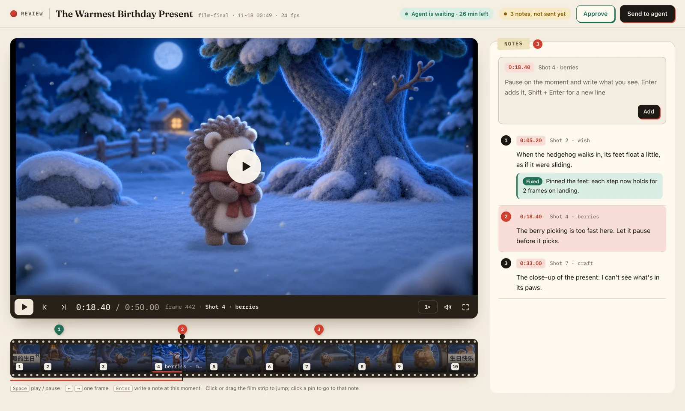

映像が完成すると、agent がブラウザでレビューページを開きます。

- **その場所にメモを書きます。** 該当する瞬間で一時停止し（Space で再生と一時停止、← → で1フレーム移動）、Enter を押して気づいたことを書きます。時間、フレーム、ショットが自動で添付され、フィルムストリップ上にピンでメモの位置が示されます。
- **送信します。** **Send to agent** をクリックします。agent はすべてのメモに対応し、それぞれの下に変更内容を返信して、次のバージョンを追加します。ページから再読み込みを求められます。以前のバージョンとそのメモは下に折りたたまれます。
- **承認します。** 問題がなければ **Approve** をクリックすると、agent が映像を納品します。

**待機時間。** ページ上部に、agent があなたを待っているかどうかと残り時間が表示されます。ページを開いてから最大 30 分間待機します。

**時間切れになっても**、何も失われません：
- メモは書いた時点で映像フォルダーに保存され、ページも引き続き動作します。
- メモを書き終えて Send または Approve をクリックし、チャットで agent に伝えてください（"done reviewing"）。agent はすべてのメモを読んで作業を続けます。
- ページを閉じてしまった場合は、agent にレビューページをもう一度開くよう頼んでください。
- ページがローカルファイルとして開いた場合（agent のサンドボックスがローカルサーバーの起動を許可しなかった場合）は、**Copy notes** を使ってメモをチャットに貼り付けてください。

## 得られるもの

- **映像**：agent が作業ディレクトリに作る映像フォルダー内の `out/<name>.mp4`。デフォルトは 1920×1080（縦長は 1080×1920、正方形は 1080×1080）、24 fps、40 秒で、オリジナル音楽とフォーリーが付きます。
- **レビューページ**：ブラウザで開き、承認するまでメモを残せます（[上記](#レビューと修正)）。
- **オプション（依頼した場合）**：あなたの言語（中国語または英語。二か国語字幕も可）のナレーションと字幕、タイトルカードとエンドカード、映像を作る前のキャラクターと主な背景の確認。
- **作業ファイル**：`production-log.md`（監督の計画と自己レビュー）、`out/contact.jpg`、ナレーション付きの場合は `<name>.srt`。

ナレーションには Microsoft Edge のオンライン音声を使うため、ナレーションのテキストは Microsoft の音声サービスに送信されます。

## ライセンス

[CC BY-NC 4.0](LICENSE)。要点は次のとおりです：

- **非商用利用は無料です。** **lemo-animi by Lemomo (LemoLab)** のクレジットを表記すれば、共有や改変ができます。映像についてはクレジットだけで十分で、リンクは不要です。
- **商用利用には商用ライセンスが必要です。** lemo-animi で作った映像を商用に使う場合も同様です（広告、クライアントワーク、収益化されたチャンネル、製品）。[lemomo.studio@gmail.com](mailto:lemomo.studio@gmail.com) までメールでご連絡ください。
- **SNS クリエイターは無料で収益化できます。** 個人で、過去12か月のクリエイター収入が 50,000 人民元以下（収入の大半がほかの通貨の場合は 7,000 米ドル以下）であれば、クレジットを表記したうえで、自分のアカウントで lemo-animi の映像から収益を得られます。クライアントワークは含まれません。詳細は [LICENSE](LICENSE) の Additional Permission for Individual Creators を参照してください。
- **サードパーティの素材はそれぞれのライセンスに従います。** Source Han Sans（SIL OFL 1.1、`plugin/skills/lemo-animi/fonts/` 内）と、セットアップでダウンロードされる楽器サンプルライブラリです。ナレーションは Microsoft の規約のもとで Microsoft Edge のオンライン音声を使用します。

## その他

- [ギャラリー](https://lemomo-ai.github.io/lemo-animi/)：すべてのスタイルとそのサンプル映像。`docs/build.py` で再構築できます。
- [SKILL.md](plugin/skills/lemo-animi/SKILL.md)：agent が従うワークフロー、ルール、ツールの全容。
- `plugin/skills/lemo-animi/styles/<id>/STYLE.md`：各スタイルの見た目と音。`plugin/skills/lemo-animi/references/`：演出、合成、音、品質チェック、落とし穴。

## LemoLab のその他のプロジェクト

- **[lemo-opuscar](https://github.com/lemomo-ai/lemo-opuscar)**：すべてコードで作った 99 の映像スタイル。
- **[lemo-wake](https://github.com/lemomo-ai/lemo-wake)**：1枚の絵から、約5秒のシームレスなループ映像を作ります。
- **[lemo-mod](https://github.com/lemomo-ai/lemo-mod)**：21 のスタイルで Claude Code の見た目を着せ替えます。

Lemomo (LemoLab) 制作 · [@lemomo_ai](https://x.com/lemomo_ai) · [lemomo.studio@gmail.com](mailto:lemomo.studio@gmail.com)
