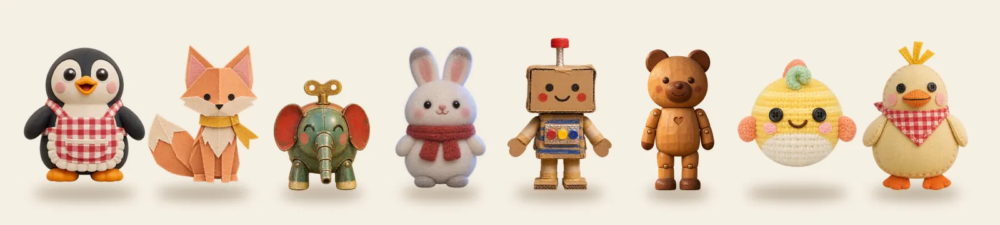
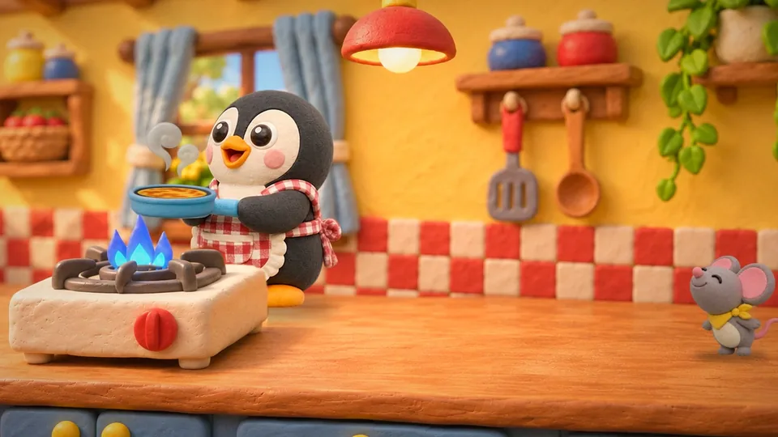
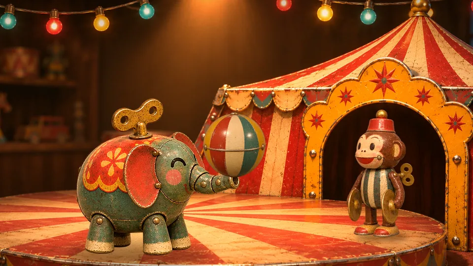
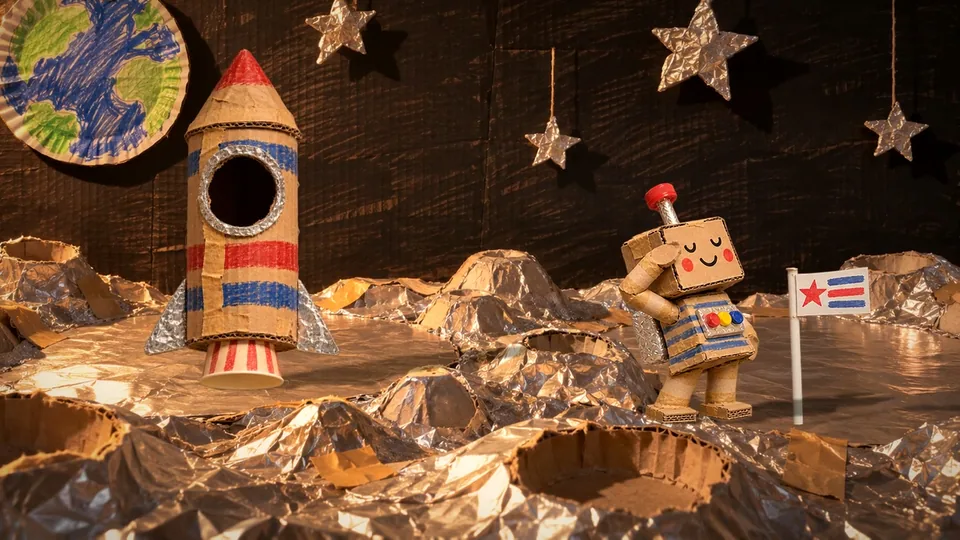
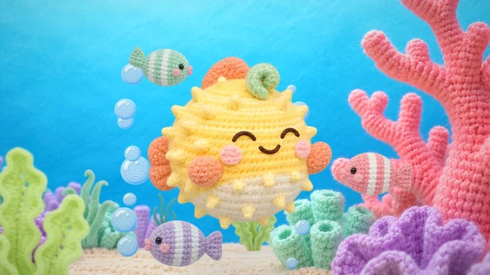
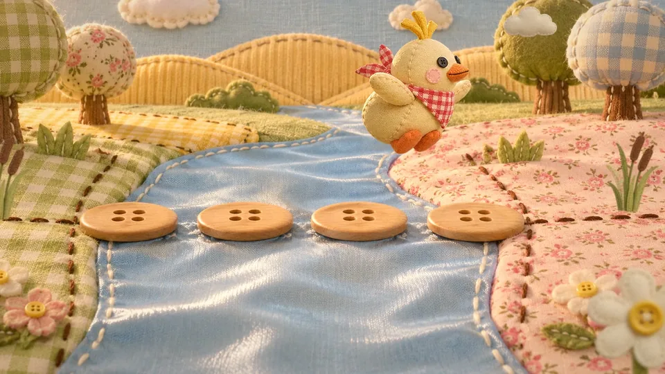
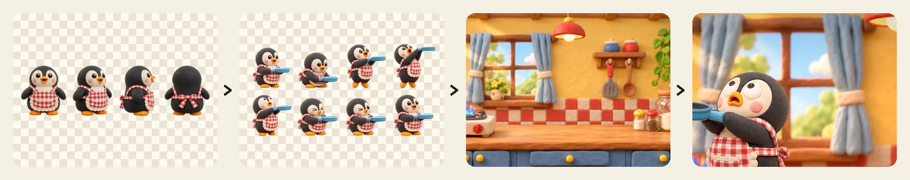
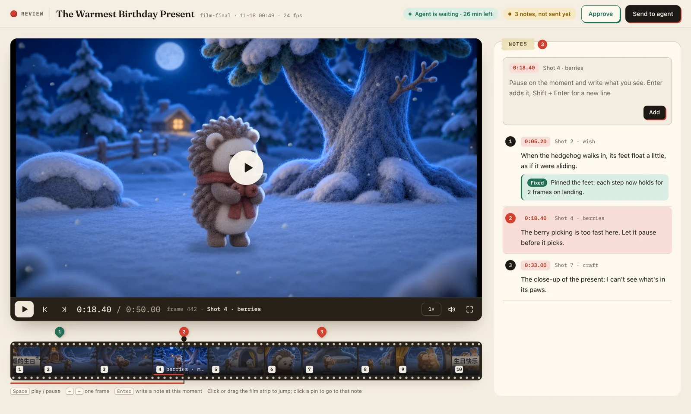

<div align="center">

<a href="https://lemomo-ai.github.io/lemo-animi/"></a>

# lemo-animi

**Stop-motion shorts from one line.** An agent skill for Codex and Claude Code.

[**Open the gallery**](https://lemomo-ai.github.io/lemo-animi/) · [Styles and films](#eight-styles-eight-sample-films) · [Install](#install) · [SKILL.md](plugin/skills/lemo-animi/SKILL.md) · [简体中文](README.zh-CN.md)

</div>

Tell your agent a story in one sentence. lemo-animi writes the story and the shot list, generates the puppets, sets and action sheets with an image model in one of eight materials, cuts them out and moves them in code, frame by frame. It scores the film from real instrument samples, adds foley and opens a review page where you leave notes until you approve. No video generation: images make it look right, code makes it move.

> **You say:** Make a 40-second clay stop-motion about a penguin learning to flip pancakes.

## Eight styles, eight sample films

<!-- styles:start (generated by docs/build.py from styles/*/style.json) -->
<table>
<tr>
<td width="50%" valign="top">
<a href="https://github.com/lemomo-ai/lemo-animi/releases/download/films/bobo-pancake.mp4"></a><br>
<b>Clay Stop-motion</b> · <code>clay</code><br>
<a href="https://github.com/lemomo-ai/lemo-animi/releases/download/films/bobo-pancake.mp4">▶ Watch <b>Bobo&#x27;s Pancake</b></a> · 53 s<br>
<sub>Oil-clay characters and sets with big squash-and-stretch faces; the funniest of the lot</sub>
</td>
<td width="50%" valign="top">
<a href="https://github.com/lemomo-ai/lemo-animi/releases/download/films/lantern-whale.mp4"></a><br>
<b>Papercraft Stop-motion</b> · <code>papercraft</code><br>
<a href="https://github.com/lemomo-ai/lemo-animi/releases/download/films/lantern-whale.mp4">▶ Watch <b>The Swimming Lighthouse</b></a> · 57 s<br>
<sub>Cut, scored and folded card in layered lightbox scenes, backlit and glowing, quiet and dreamy</sub>
</td>
</tr>
<tr>
<td width="50%" valign="top">
<a href="https://github.com/lemomo-ai/lemo-animi/releases/download/films/dudu-windup.mp4"></a><br>
<b>Tin Toy Stop-motion</b> · <code>tin</code><br>
<a href="https://github.com/lemomo-ai/lemo-animi/releases/download/films/dudu-windup.mp4">▶ Watch <b>Dudu&#x27;s Wind-up Key</b></a> · 55 s<br>
<sub>Printed tin wind-up toys from another age, moving in little jerks: wound up they live, run down they stop</sub>
</td>
<td width="50%" valign="top">
<a href="https://github.com/lemomo-ai/lemo-animi/releases/download/films/lantern-snow.mp4"></a><br>
<b>Needle-felt Stop-motion</b> · <code>felt</code><br>
<a href="https://github.com/lemomo-ai/lemo-animi/releases/download/films/lantern-snow.mp4">▶ Watch <b>A Lamp on a Snowy Night</b></a> · 57 s<br>
<sub>Needle-felted animals in the snow: fuzzy, quiet and warm, one warm lamp in a cold blue night</sub>
</td>
</tr>
<tr>
<td width="50%" valign="top">
<a href="https://github.com/lemomo-ai/lemo-animi/releases/download/films/box-moon.mp4"></a><br>
<b>Cardboard Stop-motion</b> · <code>cardboard</code><br>
<a href="https://github.com/lemomo-ai/lemo-animi/releases/download/films/box-moon.mp4">▶ Watch <b>Cardboard Moon Landing</b></a> · 58 s<br>
<sub>A kid&#x27;s imagined world built from shipping boxes, tape and markers, a little crooked and played completely straight</sub>
</td>
<td width="50%" valign="top">
<a href="https://github.com/lemomo-ai/lemo-animi/releases/download/films/lamp-bear.mp4"></a><br>
<b>Wooden Puppet Stop-motion</b> · <code>wood</code><br>
<a href="https://github.com/lemomo-ai/lemo-animi/releases/download/films/lamp-bear.mp4">▶ Watch <b>Under the Lamp</b></a> · 55 s<br>
<sub>Varnished, jointed wooden puppets coming to life one joint at a time under an oil lamp late at night</sub>
</td>
</tr>
<tr>
<td width="50%" valign="top">
<a href="https://github.com/lemomo-ai/lemo-animi/releases/download/films/pupu-puff.mp4"></a><br>
<b>Crochet Stop-motion</b> · <code>crochet</code><br>
<a href="https://github.com/lemomo-ai/lemo-animi/releases/download/films/pupu-puff.mp4">▶ Watch <b>Puff Up, Pupu!</b></a> · 58 s<br>
<sub>Yarn dolls and a whole small world hooked stitch by stitch: candy colours, busy, everything gently moving</sub>
</td>
<td width="50%" valign="top">
<a href="https://github.com/lemomo-ai/lemo-animi/releases/download/films/dou-shortcut.mp4"></a><br>
<b>Patchwork Fabric Stop-motion</b> · <code>fabric</code><br>
<a href="https://github.com/lemomo-ai/lemo-animi/releases/download/films/dou-shortcut.mp4">▶ Watch <b>Dou Takes the Shortcut</b></a> · 58 s<br>
<sub>Rag dolls and countryside sewn from floral cloth, buttons and stitches; a walk in warm sun, soft and homely</sub>
</td>
</tr>
</table>
<!-- styles:end -->

Every sample film was made by the skill on its own, from one sentence (Chinese narration and subtitles). Click a still to watch the film. Name a style in English, in Chinese or by its id; each one is a fixed package (`plugin/skills/lemo-animi/styles/<id>/`): prompt templates, lighting, camera grammar, score and foley. More styles (shadow puppetry, cut-out, plasticine relief, miniature town) are still being tested and will come in a later release.

## How it works



<sub>Character sheet → action sheet → empty background → the frame in the film. The image model draws the sheets; code cuts them into cells and moves them.</sub>

1. **It asks once.** Whatever your sentence left out (style, length, size, narration, title cards) comes in one set of questions, defaults first. Then it works through to the end.
2. **It plans.** A story skeleton with seconds per part (setup, three tries, a low point, the turn), beats, a shot list and an image list.
3. **It generates the pictures.** Character sheets, backgrounds, 8-cell action sheets and 2×2 close-up sheets on transparent backgrounds, all in one material's look.
4. **It animates in code.** The sheets are cut into cells and timed on twos (or threes), with camera moves, contact shadows, light and grade. Nothing is drawn by a video model.
5. **It adds sound.** An original score from real instrument samples, foley on every contact, and optional narration and subtitles.
6. **You review.** A local review page: pause on any moment and write a note; it fixes every note and shows you the next version until you approve. See [Review and revise](#review-and-revise).

| Film length | Shots | Generated images |
|---|---|---|
| 20 s | 2–4 | ~10–14 |
| 40 s (default) | 5–8 | ~20–26 |
| 60 s | 6–12 | ~30–38 |
| 2 min | 12–22 | ~55–68 |

## Install

**You need** macOS or Linux, `ffmpeg` (macOS: `brew install ffmpeg`), and Python 3.11–3.13 or [uv](https://docs.astral.sh/uv/).

### Codex

```sh
codex plugin marketplace add lemomo-ai/lemo-animi
codex plugin add lemo-animi@lemomo-ai
```

Start a new chat. Images come from Codex's built-in image generation.

### Claude Code (also works)

Type this in the chat, then `/reload-plugins` (or start a new session):

```text
/plugin install lemo-animi --marketplace lemomo-ai/lemo-animi
```

**Make films in auto mode.** A film runs a few hundred commands, and in the default mode Claude Code asks before each one. Press Shift+Tab until the footer shows auto mode, or start with `claude --permission-mode auto`. Skipping permissions altogether isn't needed.

Claude writes and runs the code, but it can't draw. The pictures come from one of these:

- **Codex on the same machine (default).** `npm i -g @openai/codex`, then `codex login` with an account that can generate images. lemo-animi calls it for every picture (through zsh, which macOS has; on Linux install it).
- **Your own image tool (experimental).**
  1. Copy `scripts/image_adapter.example.sh` from the skill folder (`~/.claude/plugins/cache/lemomo-ai/lemo-animi/<version>/skills/lemo-animi/`) to `~/lemo-animi-env/image.sh`.
  2. Adapt it to your tool. Keep keys in your environment, not in the file.
  3. Test it with `sh <skill folder>/scripts/setup.sh image`.

  Some things to know before you choose this:
  - Every sample film was made with Codex's image generation; other models haven't been tuned to the styles.
  - A tool that can't return a transparent background needs the optional cut-out model (`setup.sh model`, 0.97 GB), and the edges come out worse.
  - lemo-animi never edits the adapter or switches tools by itself. Delete `image.sh` to go back to Codex.

### First film

The first film needs a network connection and about 1.7 GB: a Python environment (about 300 MB) and the instrument samples for the score (about 1.4 GB, resumable), both in `~/lemo-animi-env`. It's required, so it isn't a question: the agent mentions it once with its opening questions, downloads right after you answer, and starts the film only when everything is in place. If the download fails, it shows you why and waits.

- Codex and Claude Code on the same machine share `~/lemo-animi-env`: whichever installs it first, the other doesn't download again.
- The optional cut-out model (0.97 GB) is downloaded only if an asset can't be generated with a clean transparent edge.
- `LEMO_ANIMI_HOME` moves the environment; `LEMO_ANIMI_PYTHON` picks the Python used to build it.

### Update and remove

| | Codex | Claude Code |
|---|---|---|
| Update | `codex plugin marketplace upgrade lemomo-ai` | `claude plugin marketplace update lemomo-ai`<br>`claude plugin update lemo-animi@lemomo-ai` |
| Remove | `codex plugin remove lemo-animi@lemomo-ai` | `claude plugin uninstall lemo-animi@lemomo-ai` |

Films you made earlier keep working after an update. The environment in `~/lemo-animi-env` stays when you remove the plugin; delete the folder to free the space.

### Without the plugin system

Clone the repo and link the skill folder into your agent's skills folder:

```sh
git clone https://github.com/lemomo-ai/lemo-animi.git ~/lemo-animi
mkdir -p ~/.agents/skills && ln -s ~/lemo-animi/plugin/skills/lemo-animi ~/.agents/skills/lemo-animi   # Codex
mkdir -p ~/.claude/skills && ln -s ~/lemo-animi/plugin/skills/lemo-animi ~/.claude/skills/lemo-animi   # Claude Code
```

Update with `git -C ~/lemo-animi pull`.

## Use

Ask your agent in one sentence:

```text
Make a 40-second clay stop-motion about a penguin learning to flip pancakes.
```

The short form works too: `make with lemo-animi: <story>, <style>, <length>, <size>`. To call it by name, type `$` in Codex or `/` in Claude Code and pick lemo-animi.

What happens next:

1. **It asks once.** Everything you didn't say, each as its own question with the default first: story (if you gave none), style, length (40 s by default, 20 s to 2 min), size (landscape / portrait / square), narration, title and end cards, a preview of the characters first, anything else. Codex shows them in one form, Claude Code in pop-ups of up to four. Answer "all defaults" if you like. If it can't tell your language, it asks that first; the first time, it also mentions the download.
2. **First time only: it installs the environment** (see [First film](#first-film)), and starts once it's in place.
3. **It makes the film without stopping**: director's plan, images, animation, sound, then its own review and fixes. You see only short progress notes. If you asked for a preview, it stops once to show the characters and main backgrounds.
4. **It opens the review page.** Leave notes and send them, or approve ([Review and revise](#review-and-revise)).
5. **It delivers**: the film and its files, plus a short report (what it made, the images it generated, the checks, what it isn't happy with, where the files are).

It talks to you in whatever language you write in. Narration, subtitles and title cards are in English or Chinese (English unless you write in Chinese or ask for it), and so is the review page.

**Model.** In Codex, use GPT-6.2 Sol or GPT-6.2 Astra with reasoning set to High or above. GPT-6.1 Sol and GPT-6 Astra, also at High or above, work too.

## Review and revise



When the film is ready, the agent opens a review page in your browser.

- **Write a note where it happens.** Pause on the moment (Space plays and pauses, ← → step one frame) and press Enter to write what you see. The time, frame and shot are attached for you, and a pin marks the note on the film strip.
- **Send it.** Click **Send to agent**. The agent works through every note, replies under each one with what it changed, and adds the next version; the page asks you to reload. Earlier versions and their notes fold away below.
- **Approve it.** When it looks right, click **Approve** and the agent delivers the film.

**How long it waits.** The top of the page shows whether the agent is waiting for you and how long is left. It waits up to 30 minutes after opening the page.

**If time runs out**, nothing is lost:
- Your notes are saved in the film folder as you write them, and the page keeps working.
- Finish your notes, click Send or Approve, then tell the agent in the chat ("done reviewing"). It reads every note and carries on.
- If you closed the page, ask the agent to open the review page again.
- If the page opened as a local file (the agent's sandbox wouldn't let it start the local server), use **Copy notes** and paste them into the chat.

## What you get

- **The film**, `out/<name>.mp4` in a film folder the agent makes in your working directory: 1920×1080 by default (1080×1920 portrait, 1080×1080 square), 24 fps, 40 s by default, with an original score and foley.
- **A review page** that opens in your browser, where you leave notes until you approve ([above](#review-and-revise)).
- **Optional, when you ask**: narration and subtitles in your language (Chinese or English; bilingual subtitles too), title and end cards, a look at the characters and main backgrounds before the film is made.
- **The working files**: `production-log.md` (the director's plan and self-review), `out/contact.jpg`, and `<name>.srt` when narrated.

Narration uses Microsoft Edge online voices, so the narration text is sent to Microsoft's speech service.

## Licence

[CC BY-NC 4.0](LICENSE): free for non-commercial use, with credit to **lemo-animi by Lemomo (LemoLab)**. **Commercial use needs a commercial licence, and that includes making films for commercial purposes with lemo-animi** (advertising, client work, monetised channels, products). Write to [lemomo.studio@gmail.com](mailto:lemomo.studio@gmail.com).

Third-party material keeps its own licence: the bundled Source Han Sans font (SIL OFL 1.1, `plugin/skills/lemo-animi/fonts/`) and the instrument sample libraries that setup downloads. Narration uses Microsoft Edge online voices, under Microsoft's terms.

## More

- [Gallery](https://lemomo-ai.github.io/lemo-animi/): every style with its sample film. Rebuild it with `docs/build.py`.
- [SKILL.md](plugin/skills/lemo-animi/SKILL.md): the full workflow, rules and tools the agent follows.
- `plugin/skills/lemo-animi/styles/<id>/STYLE.md`: what each style looks and sounds like. `plugin/skills/lemo-animi/references/`: directing, compositing, sound, quality checks, pitfalls.

## More from LemoLab

- **[lemo-opuscar](https://github.com/lemomo-ai/lemo-opuscar)**: 99 film styles made entirely in code.
- **[lemo-wake](https://github.com/lemomo-ai/lemo-wake)**: one picture in, a seamless loop of about five seconds out.
- **[lemo-mod](https://github.com/lemomo-ai/lemo-mod)**: re-skin Claude Code with 21 styles.

By Lemomo (LemoLab) · [@lemomo_ai](https://x.com/lemomo_ai) · [lemomo.studio@gmail.com](mailto:lemomo.studio@gmail.com)
