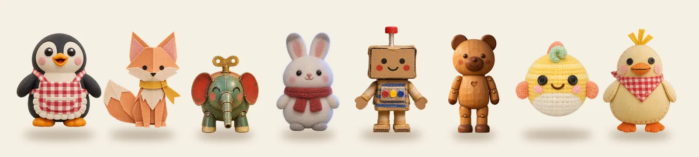
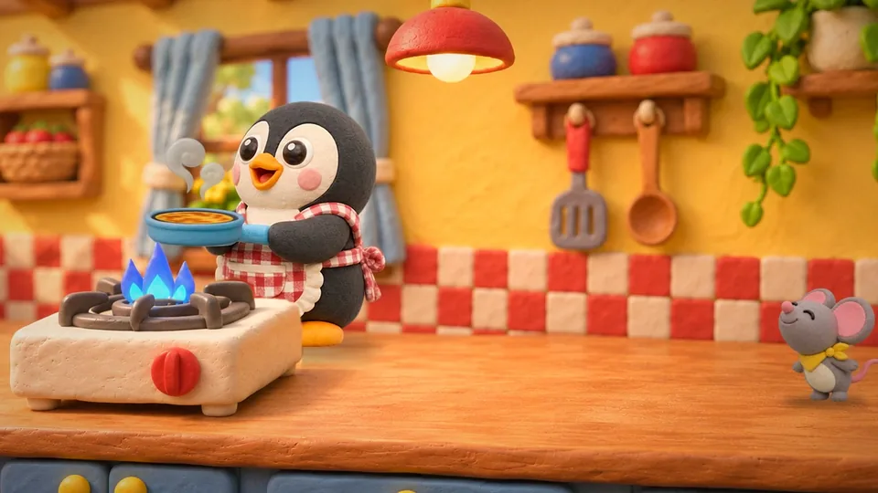
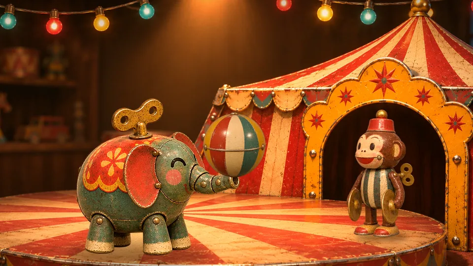
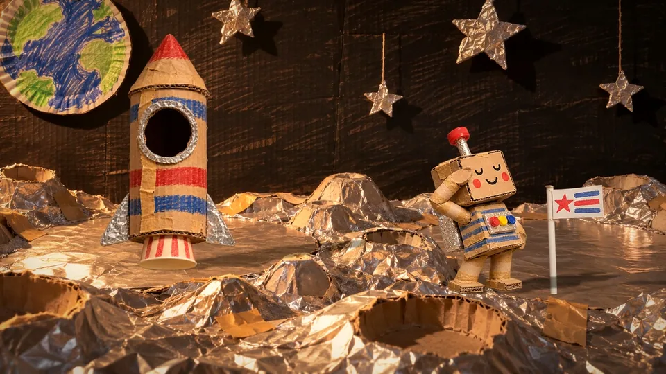
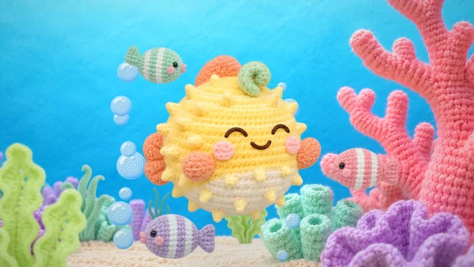
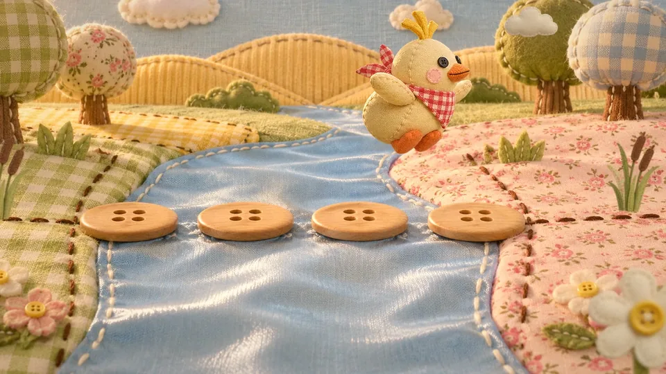
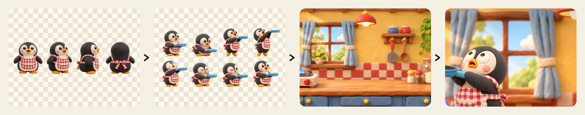
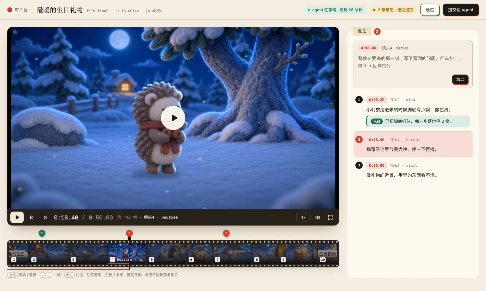

<div align="center">

<a href="https://lemomo-ai.github.io/lemo-animi/zh/"></a>

# lemo-animi

**一句话，做一支定格动画短片。** 给 Codex 和 Claude Code 用的 agent skill。

[**打开画廊**](https://lemomo-ai.github.io/lemo-animi/zh/) · [风格和样片](#八种风格八支样片) · [安装](#安装) · [SKILL.md](plugin/skills/lemo-animi/SKILL.md) · [English](README.md)

</div>

用一句话把故事告诉 agent。lemo-animi 自己写故事和镜头表，用生图模型按八种材质之一生成角色、布景和动作表，抠好以后在代码里一格一格地让它们动起来；再用真实乐器采样配乐、加拟音，最后打开审片台，你写意见、它改，直到你点通过。不用视频生成：生图负责「像」，代码负责「动」。

> **你说：** 做一支 40 秒的黏土定格动画：小企鹅学做煎饼。

## 八种风格，八支样片

<!-- styles:start (generated by docs/build.py from styles/*/style.json) -->
<table>
<tr>
<td width="50%" valign="top">
<a href="https://github.com/lemomo-ai/lemo-animi/releases/download/films/bobo-pancake.mp4"></a><br>
<b>黏土定格</b> · <code>clay</code><br>
<a href="https://github.com/lemomo-ai/lemo-animi/releases/download/films/bobo-pancake.mp4">▶ 看片 <b>《波波的煎饼》</b></a> · 53 秒<br>
<sub>油性黏土捏的角色和布景，表情夸张、压扁拉长，最有喜感</sub>
</td>
<td width="50%" valign="top">
<a href="https://github.com/lemomo-ai/lemo-animi/releases/download/films/lantern-whale.mp4"></a><br>
<b>纸艺立体定格</b> · <code>papercraft</code><br>
<a href="https://github.com/lemomo-ai/lemo-animi/releases/download/films/lantern-whale.mp4">▶ 看片 <b>《会游泳的灯塔》</b></a> · 57 秒<br>
<sub>卡纸剪刻折叠的纸雕灯箱，一层层前后排开，逆光透亮，安静又梦幻</sub>
</td>
</tr>
<tr>
<td width="50%" valign="top">
<a href="https://github.com/lemomo-ai/lemo-animi/releases/download/films/dudu-windup.mp4"></a><br>
<b>铁皮玩具定格</b> · <code>tin</code><br>
<a href="https://github.com/lemomo-ai/lemo-animi/releases/download/films/dudu-windup.mp4">▶ 看片 <b>《嘟嘟的发条》</b></a> · 55 秒<br>
<sub>印花铁皮冲压的复古发条玩具，一顿一顿地动；上紧发条就活，发条松了就停</sub>
</td>
<td width="50%" valign="top">
<a href="https://github.com/lemomo-ai/lemo-animi/releases/download/films/lantern-snow.mp4"></a><br>
<b>羊毛毡定格</b> · <code>felt</code><br>
<a href="https://github.com/lemomo-ai/lemo-animi/releases/download/films/lantern-snow.mp4">▶ 看片 <b>《雪夜的小灯》</b></a> · 57 秒<br>
<sub>戳戳乐羊毛毡做的小动物和雪景，毛茸茸、安静、温暖，冷蓝夜色里点一盏暖灯</sub>
</td>
</tr>
<tr>
<td width="50%" valign="top">
<a href="https://github.com/lemomo-ai/lemo-animi/releases/download/films/box-moon.mp4"></a><br>
<b>纸板箱定格</b> · <code>cardboard</code><br>
<a href="https://github.com/lemomo-ai/lemo-animi/releases/download/films/box-moon.mp4">▶ 看片 <b>《纸箱登月》</b></a> · 58 秒<br>
<sub>快递箱、胶带和马克笔搭出来的小孩想象世界，做得有点歪，一本正经地搞笑</sub>
</td>
<td width="50%" valign="top">
<a href="https://github.com/lemomo-ai/lemo-animi/releases/download/films/lamp-bear.mp4"></a><br>
<b>木偶定格</b> · <code>wood</code><br>
<a href="https://github.com/lemomo-ai/lemo-animi/releases/download/films/lamp-bear.mp4">▶ 看片 <b>《灯下》</b></a> · 55 秒<br>
<sub>清漆木雕的关节木偶，深夜一盏油灯下，一个关节一个关节地活过来</sub>
</td>
</tr>
<tr>
<td width="50%" valign="top">
<a href="https://github.com/lemomo-ai/lemo-animi/releases/download/films/pupu-puff.mp4"></a><br>
<b>钩织玩偶定格</b> · <code>crochet</code><br>
<a href="https://github.com/lemomo-ai/lemo-animi/releases/download/films/pupu-puff.mp4">▶ 看片 <b>《噗噗鼓起来》</b></a> · 58 秒<br>
<sub>毛线一针针钩出来的玩偶和满屏小世界，糖果色、热闹、到处都在轻轻动</sub>
</td>
<td width="50%" valign="top">
<a href="https://github.com/lemomo-ai/lemo-animi/releases/download/films/dou-shortcut.mp4"></a><br>
<b>布偶拼布定格</b> · <code>fabric</code><br>
<a href="https://github.com/lemomo-ai/lemo-animi/releases/download/films/dou-shortcut.mp4">▶ 看片 <b>《豆豆抄近路》</b></a> · 58 秒<br>
<sub>花布、纽扣和针脚缝出来的布偶和田园，暖阳下走一段路，柔软又有乡土味</sub>
</td>
</tr>
</table>
<!-- styles:end -->

每支样片都是 skill 自己从一句话做出来的（中文旁白和字幕），点静帧看完整片。风格用中文名、英文名或 id 都行；每种风格是一个固定的风格包（`plugin/skills/lemo-animi/styles/<id>/`）：提示词模板、光线、机位写法、配乐和拟音。还有几种（皮影戏、平面剪纸、彩泥浮雕、微缩模型）还在测试，以后的版本再放出来。

## 怎么做出来的



<sub>角色设定 → 动作表 → 空背景 → 成片里的那一帧。生图模型只画「表」，代码把表切成一格一格、让它动起来。</sub>

1. **开工前问一次。** 你那句话没说到的（风格、时长、画幅、旁白、片头片尾）一次问齐，默认项排第一；之后一路做到成片。
2. **先定方案。** 故事骨架和每段秒数（交代、三次尝试、低谷、转机）、节拍、镜头表、生图清单。
3. **生图。** 角色设定、背景、八格动作表、2×2 近景表，透明底，全按同一种材质的样子。
4. **代码让它动。** 动作表切成一格一格，一拍二（或一拍三）排时间，再加运镜、接触阴影、光和调色。没有一帧是视频模型画的。
5. **配声音。** 用真实乐器采样写的原创配乐，每个接触都有拟音；需要的话加旁白和字幕。
6. **你来审。** 本地审片台：停在哪一刻就在哪写意见，它逐条改完给你看新版，直到你点通过。见[审片和修改](#审片和修改)。

| 成片片长 | 镜头 | 生图张数 |
|---|---|---|
| 20 秒 | 2–4 | 约 10–14 |
| 40 秒（默认） | 5–8 | 约 20–26 |
| 60 秒 | 6–12 | 约 30–38 |
| 2 分钟 | 12–22 | 约 55–68 |

## 安装

**要先有**：macOS 或 Linux，装好 `ffmpeg`（macOS：`brew install ffmpeg`），以及 Python 3.11–3.13 或 [uv](https://docs.astral.sh/uv/)。

### Codex

```sh
codex plugin marketplace add lemomo-ai/lemo-animi
codex plugin add lemo-animi@lemomo-ai
```

装好后新开一个对话。图用 Codex 自带的生图。

### Claude Code（也可以用）

在对话里输入下面这句，再输入 `/reload-plugins`（或者新开一个会话）：

```text
/plugin install lemo-animi --marketplace lemomo-ai/lemo-animi
```

**做片子时用 auto 模式。** 一支片子要跑几百条命令，默认模式下 Claude Code 每条都会先问你。按 Shift+Tab 切到底栏显示 auto 模式，或者用 `claude --permission-mode auto` 启动。不需要完全跳过权限确认。

Claude 负责写代码、跑代码，但它自己不会画图。图从下面两处之一来：

- **本机的 Codex（默认）。** `npm i -g @openai/codex`，再 `codex login`，登录一个能生图的账号。lemo-animi 每张图都会调用它。
- **你自己的生图工具（实验功能）。**
  1. 把 skill 文件夹（`~/.claude/plugins/cache/lemomo-ai/lemo-animi/<版本>/skills/lemo-animi/`）里的 `scripts/image_adapter.example.sh` 复制成 `~/lemo-animi-env/image.sh`。
  2. 按你的工具改好。key 放在你自己的环境变量里，别写进这个文件。
  3. 用 `sh <skill 文件夹>/scripts/setup.sh image` 试一张。

  选这条路之前要知道：
  - 样片全是 Codex 生图做的，别的模型没有针对各风格调过。
  - 生不出透明底的工具，要靠可选的抠图模型（`setup.sh model`，0.97 GB），边缘会差一些。
  - lemo-animi 不会改这个文件，也不会自己切换生图工具。删掉 `image.sh` 就回到 Codex。

### 第一次做片

第一次让它做片时要联网：它会告诉你要下载什么，Python 运行环境（约 300 MB，放在 `~/lemo-animi-env`）和配乐用的乐器采样（约 1.4 GB，可断点续传），问过你才开始。

- 不联网时，只要能连上 PyPI，照样能建好运行环境，乐器采样之后再补。
- 可选的抠图模型（0.97 GB）只有某张素材生不出干净的透明边时才会下载。
- `LEMO_ANIMI_HOME` 改环境目录，`LEMO_ANIMI_PYTHON` 指定建环境用的 Python。

### 更新和卸载

| | Codex | Claude Code |
|---|---|---|
| 更新 | `codex plugin marketplace upgrade lemomo-ai` | `claude plugin marketplace update lemomo-ai`<br>`claude plugin update lemo-animi@lemomo-ai` |
| 卸载 | `codex plugin remove lemo-animi@lemomo-ai` | `claude plugin uninstall lemo-animi@lemomo-ai` |

更新以后，以前做的片子照样能接着改。卸载插件不会删 `~/lemo-animi-env` 里的运行环境，要腾空间就把这个文件夹删掉。

### 不用插件系统

把仓库克隆下来，再把 skill 文件夹链接到 agent 的 skills 文件夹：

```sh
git clone https://github.com/lemomo-ai/lemo-animi.git ~/lemo-animi
mkdir -p ~/.agents/skills && ln -s ~/lemo-animi/plugin/skills/lemo-animi ~/.agents/skills/lemo-animi   # Codex
mkdir -p ~/.claude/skills && ln -s ~/lemo-animi/plugin/skills/lemo-animi ~/.claude/skills/lemo-animi   # Claude Code
```

更新：`git -C ~/lemo-animi pull`。

## 用法

对 agent 说一句话：

```text
做一支 40 秒的黏土定格动画：小企鹅学做煎饼。
```

简写也行：`用 lemo-animi 做：<故事>，<风格>，<时长>，<画幅>`。要点名的话，在 Codex 里输入 `$`、在 Claude Code 里输入 `/`，选 lemo-animi。

没说到的（风格、时长（默认 40 秒，20 秒到 2 分钟）、横屏 / 竖屏 / 方形、要不要旁白、要不要片头片尾、要不要先看角色）开工前一次问完，默认项在第一个。之后一直做到成片，中途不停。提问、进度说明、旁白、字幕和审片台都跟着你用的语言走。

**模型**：Codex 里推荐 GPT-6.2 Sol 或 GPT-6.2 Astra，推理强度 High 及以上；GPT-6.1 Sol、GPT-6 Astra（High 及以上）也可以。

## 审片和修改



片子做好后，agent 会在浏览器里打开审片台。

- **在哪一刻就在哪写。** 停在要改的那一刻（空格播放 / 暂停，← → 一帧一帧找），按回车写下看到的问题。时间码、帧号和镜头会自动带上，胶片上会钉一枚图钉。
- **提交。** 点「提交给 agent」。agent 逐条去改，在每条意见下回复改了什么，再登记新的一版，页面会提示你刷新。旧版本和当时的意见收在下面。
- **通过。** 满意了点「通过」，agent 交片。

**等多久。** 页面顶上会显示 agent 是不是在等你、还剩多少时间。打开审片台后，agent 最多等 30 分钟。

**过了时间也不要紧，什么都不会丢：**
- 意见边写边存在片子文件夹里，页面照样能用。
- 写完点「提交给 agent」或「通过」，再回对话说一声「看完了」，agent 会读到全部意见，接着改。
- 页面关掉了，就让 agent 重新打开审片台。
- 如果审片台是以本地文件打开的（agent 的沙盒不让它起本地服务），点「复制意见」，贴进对话。

## 你会得到

- **成片**：`out/<name>.mp4`，在 agent 于你的工作目录里建的片子文件夹中。默认 1920×1080（竖屏 1080×1920，方形 1080×1080），24 帧/秒，默认 40 秒，有原创配乐和拟音。
- **审片台**：在浏览器里打开的本地网页，你写意见、它改，直到你点通过（见[上面](#审片和修改)）。
- **按需加的**：用你的语言配旁白和字幕（中文或英文，也可以双语字幕）、片头片尾、开工前先看角色和主要背景。
- **工作文件**：`production-log.md`（导演方案和自审记录）、`out/contact.jpg`，有旁白时还有 `<name>.srt`。

旁白用微软 Edge 在线语音，所以旁白文字会发到微软的语音服务。

## 许可证

[CC BY-NC 4.0](LICENSE)：非商用免费，使用时署名 **lemo-animi by Lemomo (LemoLab)**。**任何商用都需要商用授权，包括用 lemo-animi 制作商用影片**（广告、接单、带变现的频道、产品等）。请写信到 [lemomo.studio@gmail.com](mailto:lemomo.studio@gmail.com)。

第三方素材保留各自的许可证：仓库里带的思源黑体（SIL OFL 1.1，`plugin/skills/lemo-animi/fonts/`），以及安装时下载的乐器采样库。旁白用的是微软 Edge 在线语音，遵守微软的条款。

## 更多

- [画廊](https://lemomo-ai.github.io/lemo-animi/zh/)：每种风格和它的样片。用 `docs/build.py` 重新生成。
- [SKILL.md](plugin/skills/lemo-animi/SKILL.md)：agent 照着做的完整流程、规则和工具。
- `plugin/skills/lemo-animi/styles/<id>/STYLE.md`：每种风格的样子和声音。`plugin/skills/lemo-animi/references/`：导演、合成、声音、质量检查、常见坑。

## LemoLab 的其他项目

- **[lemo-opuscar](https://github.com/lemomo-ai/lemo-opuscar)**：99 种完全用代码做片的影片风格。
- **[lemo-wake](https://github.com/lemomo-ai/lemo-wake)**：一张图进去，出一段约 5 秒的无缝循环动图。
- **[lemo-mod](https://github.com/lemomo-ai/lemo-mod)**：给 Claude Code 换 21 种皮肤。

Lemomo（LemoLab）出品 · [@lemomo_ai](https://x.com/lemomo_ai) · [lemomo.studio@gmail.com](mailto:lemomo.studio@gmail.com)
